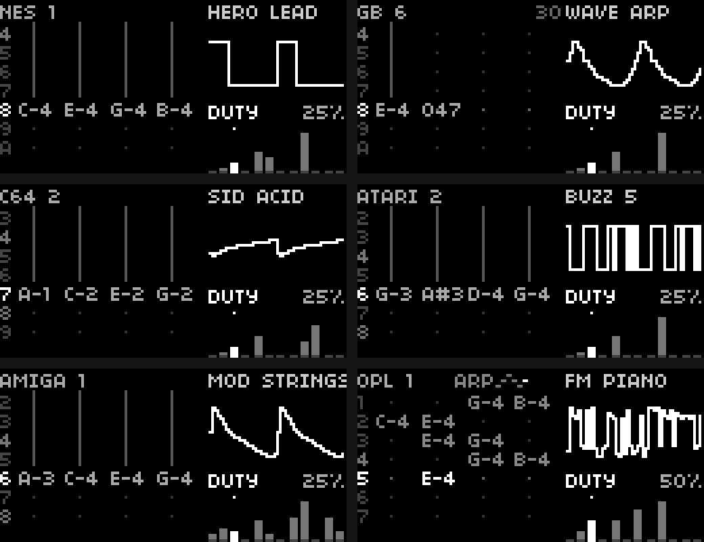
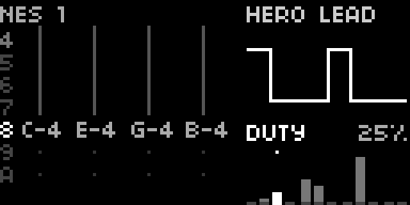
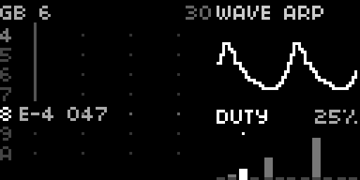
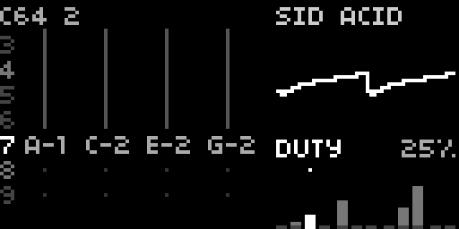
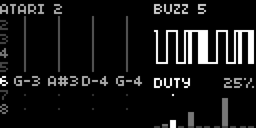
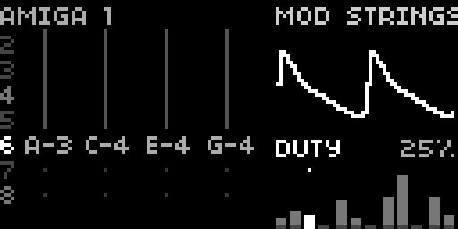
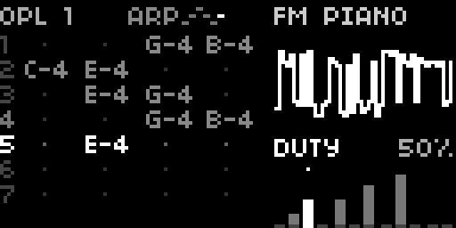

[English](README.md) · [Español](README.es.md) · [Français](README.fr.md) · [Deutsch](README.de.md) · **日本語** · [中文](README.zh.md) · [हिन्दी](README.hi.md)

# Chordex CHIP

[monome norns](https://monome.org/docs/norns/) 用のチップチューン・コード楽器。
1 つの鍵盤で 4 音のコードとベースを鳴らします（押さえている一番低い鍵盤がルート）。
音源はゲーム機のサウンドチップ風エンジン：往年のサウンドチップから着想を得た 8 バンク × 各 8 プリセット、計 64 音色。



**画面はトラッカー：**

- **左：** テンポに合わせて流れるパターン（1 行 = 1/16）。各列がコードの 1 声です。再生ラインには鳴っているノートが常に表示され、縦線は伸ばしているノート、`===` はノートオフ、`0xy` はチップ・アルペジオ（本物のトラッカーと同じ表記）。
- **上：** バンク、プリセット、`ARP` とアルペジオ・パターンの小さなアイコン（鳴っているステップが光る）、チップ・アルペジオの速さ。
- **右：** 実際に鳴っている波形を太いピクセルで表示。デューティ、PWM、ノイズ、ビット数、サンプルレート、フィルターがすでにかかった形です。その下に 12 本のフェーダー。

## 機能

- **8 バンク × 8 プリセット**：NES、GB、C64、ATARI、MSX、PCE、AMIGA、OPL。リード、ベース、ベル、パッド、アルペジオ、ドラム（三角波キック、ノイズ・スネア、爆発音、レーザー、コイン…）
- **24 種類の低ビット波形** を補間なしで 1 ステップずつ読み出す、チップそのままの鳴り方：パルス、4 ビットの NES 三角波、Game Boy と PC Engine の波形メモリ音、Amiga 風 8 ビット・サンプル、Atari 風 LFSR ノイズ、SID の saw&tri 合成波、OPL のサイン波。ゲーム機系のバンクでは音量も 16 段階で変化
- **OPL バンク**：2 オペレーター FM
- **チップ・アルペジオ**（12〜60 Hz）：ゲーム機のように 1 声でコードを高速に巡回
- **ピッチ・スイープ**、ディレイ付き **ビブラート**、**デューティ / PWM**、**ノイズ**、**ビットクラッシュ** と **サンプルレート**、レゾナンス付き **フィルター**（カットオフとレゾナンス）、テンポ同期 **エコー** とホール
- **10 種類のコード**：maj、min、dim、aug、7、maj7、min7、m7b5、sus2、sus4
- **アルペジエーター**：up、down、up-down、up x2、down x2、random、*arpa*（ハープ）。ゲート最大で本当のレガート
- **コードモード** オン/オフ（オフ = 単音）と **ホールド**
- 外部 MIDI クロックに追従してアルペジオとエコーのテンポを決定
- すべての設定は自動保存

<!-- u-ma:family -->
## Chordex ファミリー

操作は同じ、エンジンは別。ほかの楽器もどうぞ：

| | |
|---|---|
| <a href="https://github.com/buenosairesfront/chordex80/blob/main/README.ja.md"></a> | **[Chordex 80](https://github.com/buenosairesfront/chordex80/blob/main/README.ja.md)**<br>アウトランの夕焼けを描く 80 年代ポリシンセ<br>`;install https://github.com/buenosairesfront/chordex80` |
| <a href="https://github.com/buenosairesfront/chordexfm/blob/main/README.ja.md"></a> | **[Chordex FM](https://github.com/buenosairesfront/chordexfm/blob/main/README.ja.md)**<br>花として描かれる 4 オペレーター FM<br>`;install https://github.com/buenosairesfront/chordexfm` |
| <a href="https://github.com/buenosairesfront/chordexstg/blob/main/README.ja.md"></a> | **[ChordexSTG](https://github.com/buenosairesfront/chordexstg/blob/main/README.ja.md)**<br>弓で擦った弦の実際の動きを描くオーケストラ弦楽<br>`;install https://github.com/buenosairesfront/chordexstg` |
| <a href="https://github.com/buenosairesfront/chordexwt/blob/main/README.ja.md"></a> | **[Chordex WT](https://github.com/buenosairesfront/chordexwt/blob/main/README.ja.md)**<br>8 波形 × 8 バンクのウェーブテーブル。3D テーブルとして描画<br>`;install https://github.com/buenosairesfront/chordexwt` |
| <a href="https://github.com/buenosairesfront/chordexabnt/blob/main/README.ja.md"></a> | **[Chordex ABNT](https://github.com/buenosairesfront/chordexabnt/blob/main/README.ja.md)**<br>パッド、アンビエント、リード、テクスチャー：4 ファミリー × 8 プリセット、アルペジエーターの代わりにムーブメント<br>`;install https://github.com/buenosairesfront/chordexabnt` |

**U-MA のほかの作品：** すべての楽器とツールをひとつに → [U-MA ショーケース](https://github.com/buenosairesfront/U-ma/blob/main/README.ja.md)
<!-- /u-ma:family -->

## 必要なもの

- norns（shield、標準モデル、fates）
- MIDI キーボードまたはコントローラー

## インストール

maiden から：

```
;install https://github.com/buenosairesfront/chordexchip
```

その後、新しいエンジン `ChordexCHIP` をコンパイルするために **norns を再起動**（SYSTEM > RESTART）し、SELECT から **chordexchip** を読み込みます。

## 操作

| 操作 | 機能 |
|---|---|
| E1 | バンク内のプリセット |
| E2 | フェーダー選択 |
| E3 | フェーダー調整 |
| K3 + E1 | バンク |
| K3 + E2 | チップ・アルペジオ（オフ、12〜60 Hz） |
| K3 + E3 | コードの種類 |
| K3 長押し（回さずに） | コードモード オン/オフ |
| K2（タップ） | アルペジエーター オン/オフ |
| K2 + E1 | アルペジオのゲート（最大 = レガート） |
| K2 + E2 | アルペジオのパターン |
| K2 + E3 | アルペジオの速度 |
| K2 + K3 | STRUM パネルを開く（開いたまま。最後の操作から 3 秒、または再び K2 + K3 で閉じる）：E3 = コード音の間隔を拍の分割で（MIDI クロックがあればそれ、なければ norns のテンポ）；+ は最初の音から最後へ、− は最後から最初へ |
| K1 長押し | ホールド オン/オフ（上部の小さな点） |

**フェーダー：** アタック、ディケイ、デューティ、PWM、スイープ、ビブラート、ノイズ、ファットネス、カットオフ、レゾナンス、ビット数、サンプルレート。OPL バンクではデューティが FM の深さになります。

**PARAMETERS メニュー：** MIDI チャンネル（0 = 全チャンネル、初期値）、MIDI クロック分周、サステイン、スイープ時間、オクターブ、ベース音量、エコー、ホール、音量、および上記すべて。

## ギャラリー

| | |
|---|---|
|  NES · HERO LEAD · maj7 |  GB · WAVE ARP · チップ・アルペジオ `047` |
|  C64 · SID ACID · min7 |  ATARI · BUZZ 5 |
|  AMIGA · MOD STRINGS · min7 |  OPL · FM PIANO · アルペジオ |

## クレジット

制作：[Buenos Aires Front](https://github.com/buenosairesfront) / U-MA。
バンク名は着想元のサウンドチップを指すもので、本プロジェクトは Nintendo、Commodore、Atari、MSX コンソーシアム、NEC、Hudson Soft、Yamaha とは一切関係ありません。MIT ライセンス。
